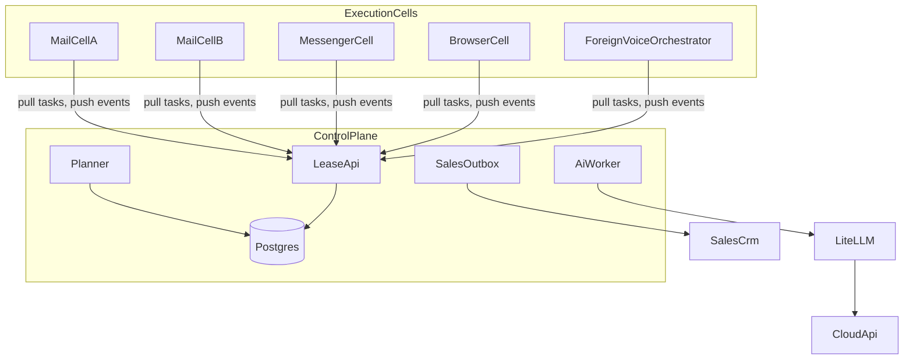
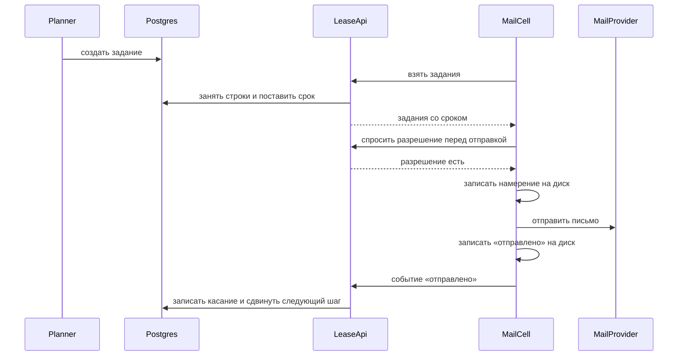

# Архитектура

Редакция 3 от 16.11.2026. Написана до аудита существующей системы RE-PUT, поэтому всё, что касается Mailer, Collector и AI Worker, — предположения до первой недели работы. Числа объёмов — оценки; расчёт лежит в `src/vm/planning/capacity.py`. Обоснование решений — в [adr/](adr/). Рабочий почтовый парк — 40–60 ящиков Gmail компании, решение в [adr/0008](adr/0008-gmail-fleet-domain-conveyor-is-a-test.md).

## 1. Задача и границы

Платформа делает первое касание с компанией-адресатом по нескольким каналам, разбирает ответ языковой моделью (интент, возражение, отправка КП) и передаёт тёплый лид в отдел продаж.

Объём со встречи: 350 тыс. касаний в месяц, затем 455 тыс. и около 590 тыс., далее +7% в месяц. Это 0,13–0,23 задания в секунду; через четыре года такого роста — около 5 в секунду. Вычислительной проблемы здесь нет. На старте ограничивают система 40–60 уже имеющихся пар «ящик + номер», доля ответов и пропускная способность отдела продаж. База — около 7 млн записей с почтой, телефоном и отметками мессенджеров.

В проект не входит: регистрация номеров и ящиков на несуществующих людей, покупка аккаунтов, скрипт регистрации, подмена отпечатка браузера, переписка ящиков между собой ради доли жалоб. Код из SMS API нужен для входа в учётную запись компании, которая уже есть. Причины — в [RISKS.md](RISKS.md).

## 2. Общая схема

Две плоскости:

- **Плоскость управления** — одна. Решает, кому, когда, по какому каналу и от чьего имени писать. Хранит лиды, стоп-лист, лимиты, историю.
- **Плоскость исполнения** — много независимых ячеек. Ячейка отправляет и принимает, ничего не решает.

## 3. Плоскость управления

Один процесс (FastAPI) и один Postgres. AI Worker — отдельный процесс рядом.

Компоненты:

- **Планировщик** — раз в минуту создаёт задания с учётом дневного лимита идентичности, часового пояса адресата, отметок каналов в записи и стоп-листа. Каскад: письмо на почту записи, затем звонок на телефон этой же записи с номера, привязанного к ящику. Следующий канал берётся только если он в записи отмечен. Прогрев домена учитывается только у ящиков доменного теста.
- **API аренды** — выдаёт ячейке задания на ограниченный срок, принимает события, отвечает на запрос разрешения перед отправкой.
- **AI Worker** — разбирает входящие. Контракт «текст и история диалога → решение» (интент, текст ответа, признак «отправить КП», признак «передать в продажи»). Доступа к базе и к почте у него нет: только так этот кусок можно отдать нанятому человеку.
- **Исходящая таблица** — надёжная доставка webhook в отдел продаж с ключом и повторами.
- **Выключатели** — общий, по каналу, по ячейке, по идентичности.

### Как работает аренда

«API аренды» (на схеме — LeaseApi) — не отдельный продукт и не библиотека. Это несколько HTTP-методов того же приложения FastAPI и таблица `task` в Postgres.

Аренда — выдача задания под расписку на короткий срок. Она нужна, чтобы одно письмо не ушло дважды и чтобы задание не потерялось, если ячейка упала.

1. Ячейка спрашивает: «дай до 10 заданий для моих ящиков». Плоскость управления выбирает строки, помечает их «выдано ячейке A до 12:05, выдача № 1» и возвращает.
2. Перед каждым письмом ячейка спрашивает: «задание ещё в силе?» Ответ «нет», если адресат успел отказаться, включён выключатель или срок истёк.
3. Ячейка отправляет письмо, пишет отметку себе на диск и сообщает факт «отправлено».
4. Если ячейка молчит дольше срока, задание выдаётся заново с № 2. Отчёт с № 1 после этого не принимается, а отметка на диске не даёт вернувшейся ячейке отправить то же письмо ещё раз.

Методы, которые появятся вместе с сервисом: `POST /v1/leases`, `POST /v1/tasks/{id}/permit`, `POST /v1/events`, `POST /v1/heartbeat`. В контракте задания (`src/vm/contracts/tasks.py`) уже есть `lease_token` и `lease_expires_at`; номера выдачи ещё нет.

Основные таблицы:

| Таблица | Что хранит |
|---|---|
| `lead` | компания-адресат, состояние каскада, `next_action_at`, версия строки |
| `contact_point` | адрес лида в конкретном канале, отметка «канал есть», признак основного телефона, часовой пояс |
| `cell` | ячейка, канал, провайдер, состояние, время последнего сердцебиения |
| `identity` | пара «ящик компании + номер компании», ячейка, дневной лимит, состояние. Домен заполнен только у ящика доменного теста. Без паролей |
| `task` | задание, ключ идемпотентности (уникальный), токен и срок аренды |
| `touch` | факт состоявшегося касания |
| `message` | входящие и исходящие сообщения диалога |
| `stop_list` | адрес, домен или лид, причина, источник |
| `outbox` | события для отдела продаж |
| `kill_switch` | область, цель, причина, кто включил |

Состояние лида меняет только плоскость управления, и только с проверкой версии строки. Иначе планировщик и обработчик входящих затирают друг друга: либо второе письмо после ответа, либо лид зависает.

## 4. Ячейки исполнения

Ячейка — небольшой узел у отдельного хостинг-провайдера со своим исходящим адресом и закреплённым набором идентичностей. Для почты на текущем парке ячейка держит часть из 40–60 ящиков, не весь парк на одном адресе. Ориентир «10 доменов и 40 ящиков» относится к доменному тесту, если он будет запущен.

| Тип | Что делает | Этап |
|---|---|---|
| Почтовая | отправка и сбор ответов по своим ящикам Gmail | 1 |
| Голосовая | внешний оркестратор, Vapi или другой зарубежный. Своего контура нет | 3 |
| Мессенджер | WhatsApp, затем ВКонтакте и Telegram, с номера идентичности | 4 |
| Браузерная | формы обратной связи и чаты на сайтах (Playwright) | 5 |

Свойства ячейки:

- сама ходит в плоскость управления по HTTPS; входящих соединений не принимает, доступа к базе не имеет;
- хранит пароли своих ящиков в зашифрованном виде; плоскость управления их не знает. Зашифрованная копия секретов лежит вне ячейки, ключ — у ведущего инженера;
- получает минимум данных: адрес и текст, без остальной базы лидов;
- идентичность закреплена за ячейкой постоянно и между ячейками не переезжает;
- браузерные ячейки стоят отдельно от почтовых: процесс, открывающий чужие сайты, не должен находиться рядом с паролями ящиков.

Путь одного задания:

## 5. Правила, которые нельзя нарушать

1. Без действующей аренды ячейка ничего не отправляет.
2. Отметка «отправлено» пишется на диск ячейки до отчёта в плоскость управления. Повтор задания с тем же ключом наружу не уходит.
3. Счётчик дневного лимита ячейки переживает перезапуск. Если он не читается — отказ, а не «ноль».
4. Прямо перед отправкой ячейка запрашивает разрешение: стоп-лист и выключатели проверяются повторно. Отказ адресата может прийти, пока следующее письмо уже в аренде.
5. Срок аренды считается по часам сервера и задаётся по каналу: у браузера и звонка он длиннее, чем у письма. У аренды есть номер выдачи; при повторной выдаче он растёт, отчёт со старым номером отклоняется.
6. Ячейка присылает факты; состояние лида она не меняет.
7. После восстановления базы из копии планировщик не запускается, пока не закончена сверка с журналами ячеек. Сверка не только запрещает повтор, но и дописывает в базу пропущенные факты: отправленные письма и входящие отказы.
8. Лимит проверяется на трёх уровнях: планировщик, API аренды, ячейка.
9. Webhook в продажи уходит только через исходящую таблицу с ключом. Событие Vapi «согласие получено» — тоже факт в плоскость управления: КП после звонка идёт через задание и аренду, а не прямой отправкой из обработчика.
10. Отказ адресата исполняется навсегда и во всех каналах.

Общий приёмочный тест для любой ячейки: повторно выданное задание не уходит наружу второй раз. Уровни тестов, стенды и опыты на проде — в [TESTING.md](TESTING.md). Как заводятся и ведутся ящики — в [MAILBOXES.md](MAILBOXES.md).

## 6. Связь с существующей системой

| Сейчас | Роль в новой схеме | Что проверить на аудите |
|---|---|---|
| Mailer | отправка в почтовой ячейке | лимит на ящик и где он хранится; что происходит при повторном запуске; где лежат пароли |
| Collector | приём в той же ячейке; события уходят в плоскость управления | зачем общий ящик; как ответ связывается с исходным письмом; автоответы и отказы доставки |
| AI Worker | модуль за контрактом «текст → решение» | модель, промпты, классы интента, примеры ошибок, есть ли размеченные диалоги |
| Webhook в продажи | исходящая таблица | формат, что происходит при повторе |
| Vapi | внешняя голосовая ячейка. Другой зарубежный оркестратор — смена адаптера | какие события отдаёт, где лежат записи звонков |
| Номер компании и SMS API | пара идентичности и код входа в её учётную запись | как устроен доступ: веб, API, откуда берётся SMS |
| База лидов | импорт в плоскость управления, около 7 млн записей | поля почты, телефона, основного номера и отметок мессенджеров |

По каждому из трёх агентов после аудита принимается решение: оставить, обернуть адаптером под контракт или заменить. Общий ящик Collector заменяется сбором на ячейке при любом исходе: это единая точка отказа входящих, и через неё все ящики связаны одним узлом. Чек-лист аудита — в [ROADMAP.md](ROADMAP.md), раздел «Чек-лист аудита».

## 7. Децентрализация: что теряем при отказе

| Отказ | Что останавливается | Что продолжает работать | Восстановление |
|---|---|---|---|
| Почтовая ячейка | её ящики | остальные ячейки | новая ячейка из шаблона, секреты из зашифрованной копии |
| Один ящик Gmail или его номер | эта пара | остальные пары | докупка такой же пары, если замер уже разрешил рост |
| Политика Gmail на весь класс ящиков | почта этого класса | голос и мессенджеры, доменный тест если он уже идёт | автопауза класса; отчёт, а не аварийный заказ доменов |
| Домен доменного теста | ящики этого домена | Gmail и остальные домены опыта | опыт останавливается по своим порогам, рабочий парк не ждёт |
| Хостинг-провайдер ячеек | ячейки у него | ячейки у других | перенос ячеек к другому провайдеру |
| Плоскость управления | выдача новых заданий | ячейки доделывают выданное, входящие копятся на ячейках | подъём из копии по письменному сценарию, затем сверка |
| API моделей | разбор ответов | отправка первых сообщений по готовым текстам | смена модели в том же шлюзе. Своей видеокарты на старте нет |
| Зарубежный оркестратор | звонки | остальные каналы | другой зарубежный оркестратор тем же контрактом факта |
| Канал мессенджера | этот канал | почта, голос и остальные мессенджеры | выключатель канала. Обхода недоставки нет |

Плоскость управления — осознанная точка централизации. Её отказ даёт паузу, а не потерю данных и не повторные письма. Несколько независимых «мозгов» давали бы обратное: система не останавливается, но один адресат получает два письма, а отказ, пришедший в одну ячейку, не известен другой.

Два уточнения, без которых эта таблица не выполняется:

- Ежедневная копия базы отстаёт до суток. Стоп-лист и журнал событий поэтому выгружаются за пределы плоскости управления чаще, раз в час: потерянный отказ адресата — худший вид потери.
- Резерв доменного теста, если тест запущен, не простаивает: молчащий домен через несколько недель перестаёт быть резервом. На текущий парк Gmail это правило не переносится. Там резерв — запасные пары «ящик + номер», и они тоже отправляют свою небольшую долю, иначе лимит и репутация ящика неизвестны в день, когда сосед встал на паузу.

## 8. Как это масштабируется

Мощность равна числу идентичностей, умноженному на дневной лимит одной. Рост — горизонтальный:

1. Докупка пар «ящик компании + номер компании» после замера доли ответов. Новая пара начинает с измеренного лимита, а не с прогрева домена.
2. Заполнена ячейка — поднимается следующая из шаблона у другого провайдера.
3. Новый канал — новый тип ячейки за тем же контрактом; плоскость управления не меняется. Канал создаёт касания только по отметке в записи.
4. Доменный конвейер добавляется к парку, только если тест из [adr/0008](adr/0008-gmail-fleet-domain-conveyor-is-a-test.md) выигран.
5. Новая страна — отдельная плоскость управления со своей базой лидов (см. [adr/0001](adr/0001-control-plane-and-cells.md)).

Расчёт текущего парка и потребности в ящиках на 350 тыс. писем — в [VISION.md](VISION.md), раздел 1. Таблица «90 доменов на 350 тыс.» описывает доменный тест в случае его победы, а не стартовый парк. Стартовый парк — 40–60 пар и даёт 48–180 тыс. писем в месяц в границах лимита 40 или 100 в день, до замера.

Чего одна почта не даст: при +7% в месяц через четыре года потребовалось бы около 12 млн касаний в месяц — это больше 10 тыс. ящиков и больше, чем записей в базе около 7 млн. Рост за пределами первого года идёт через каналы, которые в записи уже отмечены, и через новые рынки.

## 9. Модели

Все вызовы идут через шлюз LiteLLM; код не знает, какая модель отвечает. На старте маршрут один — облачный API. Узел с видеокартой не арендуется: под речь он не нужен, под тексты вопрос откроется, только если счёт за модели устойчиво выше аренды узла. Доводы — в [adr/0004](adr/0004-llm-api-first-gpu-second-route.md).

## 10. Границы для найма

Каждый кусок закрыт контрактом заданий и событий (`src/vm/contracts/`) и приёмочными тестами, поэтому его можно отдать отдельному человеку:

- почтовая ячейка и доставляемость;
- браузерная ячейка;
- адаптер зарубежного голосового оркестратора;
- ячейка мессенджера (WhatsApp, ВКонтакте, Telegram);
- разбор ответов: промпты и эталонный набор;
- развёртывание ячеек из шаблона и мониторинг;
- аналитика воронки.

Плоскость управления остаётся у ведущего инженера. Подробнее — в [adr/0007](adr/0007-modular-monolith-and-hiring-boundaries.md).

## 11. Стек

- Python 3.12, FastAPI, pydantic, httpx, pytest, ruff.
- Postgres, SQLAlchemy 2, Alembic. Очередь — таблица заданий с арендой.
- Почта: aiosmtplib и IMAP. Формы: Playwright. Модели: LiteLLM. Голос: адаптер оркестратора. Мессенджер: отдельная ячейка на номере идентичности.
- Развёртывание: Docker Compose, шаблон ячейки.

## 12. Что намеренно отложено

На первые два месяца не делаем: Prometheus и Grafana (достаточно сердцебиения ячеек в таблице и оповещений в Telegram), автоматическое переключение базы на реплику (достаточно ежедневной копии у другого провайдера и проверенного восстановления), Ansible на весь парк, собственный голосовой контур, узел с видеокартой, заказ доменов до решения по тесту.

Не откладываем: контракт заданий и событий, аренду, стоп-лист, лимиты в базе, локальный журнал ячейки, привязку идентичности к ячейке.
