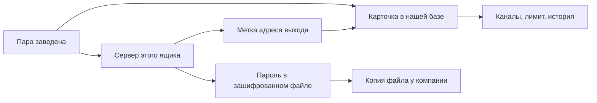

# Видение: первый контакт на объёмах плана

Денис Бутылин. Редакция 19.11.2026. Для Алексея и руководителя отдела продаж.

## Коротко

Система делает первое касание и передаёт отделу тех, кто ответил или согласился получить предложение. Объёмы берём из плана: 350 тысяч касаний в первый месяц, 455 тысяч во второй, 591,5 тысячи в третий. Это плюс 30% каждый месяц. Такой темп держится весь первый год: к 12-му месяцу выходит около 6,3 млн касаний. Со второго года по четвёртый темп плюс 7% каждый месяц. Под эти числа отдел продаж считает людей.

Ящики, которые уже пишут, остаются в старой отправке. Результат считаем на новых ящиках. Учёт ведём внутри компании. Номер и код SMS приходят от вендора по API. Первые три пары заводит инженер, остальные — отдельный человек на этот проект.

Первое письмо — предложение помочь сохранить репутацию на площадках. Текст выверен. В письме есть отправитель и отписка. Отказ останавливает все каналы.

Каналы: почта, WhatsApp, ВКонтакте, Telegram, звонок, чат на сайте, форма на сайте. Пишем туда, где у компании этот канал есть. Почта и телефон одной записи связаны. После письма известно, на какой номер звонить. Звонок идёт с номера того ящика, который письмо отправил.

Голос ведёт Vapi или другой зарубежный оркестратор. Свои видеокарты для звонков не нужны.

## План по месяцам

Касание — одно обращение в одном канале.

| Месяц | Касаний в месяц | Касаний в день |
|---|---|---|
| 1 | 350 000 | около 11 700 |
| 2 | 455 000 | около 15 200 |
| 3 | 591 500 | около 19 700 |
| 4–12 | плюс 30% каждый месяц | к 12-му месяцу около 6,3 млн |
| со 2-го по 4-й год | плюс 7% каждый месяц | |

Основной объём несёт почта: около 100 писем в день с одного ящика, круглосуточно. На встрече это и есть девять писем в минуту.

| Месяц | Ящиков на 100 писем в день |
|---|---|
| 1 | 117 |
| 2 | 152 |
| 3 | 198 |

## Срок набора ящиков

100 писем в день с одного ящика Gmail — подтверждённый предел. На 350 тысяч в первый месяц нужно 117 новых ящиков. Уже работающие в этот счёт не входят. Номер и код из SMS даёт вендор. Для старта ему нужно заранее отдать 117 номеров с рабочим SMS.

Регистрация ручная, 6 часов в день. Одна пара занимает от 5 до 15 минут. Номер, который форма не принимает, меняется на следующий из пула.

| | 5 минут на пару | 15 минут на пару |
|---|---|---|
| Пар в день | 72 | 24 |
| 117 пар, первый месяц | 2 рабочих дня | 5 рабочих дней |
| Ещё 35 ко второму месяцу | меньше одного дня | 2 рабочих дня |
| Ещё 46 к третьему месяцу | меньше одного дня | 2 рабочих дня |

Первые три пары заводит инженер и в тот же день подключает их к отправке. Остальные заводит отдельный человек на этот проект. Он не из отдела продаж: ящики не ведёт и пароль не оставляет. Готовые пары в эти же дни уже пишут по 100 писем. Ко второму месяцу в парке 152 ящика, к третьему 198.

Дальше в первом году темп касаний тот же, плюс 30%. Одной почтой на 100 писем в день он к 12-му месяцу потребовал бы около 2 100 ящиков. После первых месяцев объём добавляют каналы, которые отмечены у адресата и которые площадка принимает.

## Срок мессенджеров

Мессенджер садится на тот же номер, что и почтовый ящик. Отдельный номер под него не заводим. На панели SIM Folder 19.11.2026 было 1536 SIM-карт, 1070 в работе, свободно 466. На 117 пар этого запаса хватает, если свободная карта принимает SMS. Карты, которые уже в работе, под новые пары не берём.

Месячный объём несёт почта. Мессенджер добавляет касание только у компании, где этот канал отмечен, и только если площадка принимает первое сообщение. У WhatsApp, ВКонтакте и Telegram свой выключатель. Если первое сообщение не доходит, серия идёт дальше по почте и звонку.

Рабочее место — отдельный компьютер на Windows или Linux, с Android и эмулятором. Если канал на эмуляторе не живёт, к этому компьютеру подключается телефон по USB. Код входа читается из SIM Folder. Это не сервер AMOCRM и не компьютер менеджера.

Минуты на один вход ещё не засечены. До первых трёх входов берём ту же вилку, что у почты: 5–15 минут, 6 часов в день. Один канал на 117 пар — 2–5 рабочих дней, три канала — 5–15. Набор идёт после почтовых ящиков и месяц почты не задерживает. Около 100 сообщений в день и 18 часов — ориентир встречи, не обещание объёма. Порог, на котором площадка блокирует номер, опытом не ищем.

## Что получает отдел продаж

По ответу на письмо: удовлетворительно 0,5%, хорошо 1%, отлично 2%. Отдел планирует людей под хороший результат, 1%, и под полный месяц: 117 ящиков по 100 писем дают около 117 ответов в день. Пока набор не дошёл до 117, ответов меньше.

| Месяц | Ответов в день при 0,5% | при 1% | при 2% |
|---|---|---|---|
| 1 | 58 | 117 | 233 |
| 2 | 76 | 152 | 303 |
| 3 | 99 | 197 | 394 |

Карточка создаётся, когда человек ответил или в звонке согласился получить предложение. Один клиент — одна карточка.

По текущей модели компании из тех, кому после согласия ушло предложение, клиентами становятся 6%. На хорошем результате первого месяца это около 3 500 ответов и около 210 клиентов, если предложение получили все ответившие. Во второй месяц около 270 клиентов, в третий около 350.

Звонок, как и раньше, даёт около 30% согласий «пришлите информацию». Предложение после согласия уходит само, на почту или в мессенджер этой записи.

В сигнал отделу входят компания, канал, переписка первого касания, ушло ли предложение, запись звонка и номер, с которого звонили. Входа в аккаунт первого касания в этом сигнале нет. Сигнал создаётся в двух случаях: положительный интент на почте или в звонке и любой ответ в мессенджере — WhatsApp, ВКонтакте или Telegram. Повтор того же ответа второй сигнал не создаёт.

Менеджеры отдела работают в одной среде, в AMOCRM. В систему первого касания и в аккаунты, с которых ушло касание, их не пускаем. Дальше диалог ведётся из AMOCRM с одного рабочего аккаунта отдела. Как клиент переходит на каналы отдела, опишет руководитель отдела или Алексей. Отказ в AMOCRM закрывает компанию во всех каналах первого касания.

Молчание компанию не закрывает. За месяц по одной компании делаем не меньше 12 касаний. Они идут по каналам, которые у неё есть, с паузой, а не пачкой в один день. Ответ или отказ останавливают серию раньше. Поэтому 350 тысяч касаний по-прежнему дают около 117 ответов в день при 1%: одна компания за месяц может забрать из них несколько касаний.

## Как идёт одна компания

1. Есть почта — отправляем предложение помочь с репутацией на площадках.
2. Ответа нет — следующее касание в другом канале этой записи. После письма звоним на телефон той же записи с номера ящика, который уже написал.
3. Каналы кончились, а ответа нет — в том же месяце возвращаемся ещё раз.
4. Есть положительный интент на почте или согласие в звонке — предложение уходит на почту или в мессенджер записи, в том числе в WhatsApp. В AMOCRM падает один сигнал. Диалог продолжает отдел со своего рабочего аккаунта.
5. Есть ответ в WhatsApp, ВКонтакте или Telegram — в AMOCRM падает такой же сигнал, с перепиской этого канала. Отдел в аккаунт мессенджера не входит.
6. Отказ в любом канале закрывает компанию везде.
7. За месяц набралось 12 касаний и ответа нет — до следующего месяца не пишем.

Мессенджеры и звонки идут 18 часов, с учётом часового пояса компании. Почта идёт круглые сутки, не больше 100 писем с ящика.

## Каналы

- **Почта.** Старт и основной объём. Новый ящик Gmail и номер этой пары.
- **Звонок.** Vapi или другой зарубежный оркестратор. Согласие само ставит отправку предложения.
- **WhatsApp, ВКонтакте, Telegram.** Тот же номер и та же ячейка, что у ящика. Канал включается после почты и только там, где площадка принимает первое сообщение. У каждого свой выключатель. Около 100 сообщений в день и 18 часов — ориентир встречи, не обещание объёма: месяц держит почта. Max в этот список не входит и ждёт отдельного решения Алексея.
- **Чат и форма на сайте.** Ответ приходит на тот же ящик.

Если канал молчит, берём следующий, который у компании есть. Остановка одного канала не останавливает остальные и не заканчивает кампанию.

## Где живёт учётная запись

Первый месяц закрывает почта. Первые три пары заводит инженер, набор до 117 ведёт регистратор. Мессенджер на той же паре включается позже и только если площадка принимает первое сообщение.

Учётная запись разделена на карточку и пароль.

Карточка отвечает на вопрос «какой это ящик». Она хранится в нашей базе: адрес, номер компании, какие каналы с него можно вести, сколько писем в день разрешено, какой сервер с этого ящика отправляет и история с того дня, когда пара заведена. Пароля в карточке нет. По карточке программа решает, кому писать и с какого ящика. Сама она войти в почту не может. Список карточек — это окно на ящики и на мессенджеры тех же пар.

Пароль отвечает на вопрос «как войти». Он лежит только на том сервере, который отправляет почту с этого ящика, в зашифрованном файле, рядом с паролями других ящиков этого сервера. Если сервер потеряется, ящик у почты останется, а войти будет нечем. Поэтому зашифрованная копия того же файла хранится у компании, отдельно от базы клиентов. Общая база эту копию не читает и письма ею не отправляет.

Адрес выхода отвечает на вопрос «с какого места выходит эта пара». Он записан меткой на том же сервере и виден в карточке. Пара закреплена за этой ячейкой и на другую не переезжает.

Пример одной записи. В базе: ящик `manager-17@gmail.com`, номер компании, лимит 100 писем в день, отправляет сервер номер 3, история писем и входов. На сервере 3: пароль этого ящика и метка адреса выхода. В базе клиентов этого пароля нет.

Письмо уходит так. Программа смотрит карточку и говорит серверу 3: отправь текст на такой-то адрес, это твоё задание. Сервер сам берёт пароль из своего файла, отправляет письмо и сообщает, что письмо ушло. Пароль по сети в общую базу не возвращается. Мессенджер этой пары, если канал включён, выходит с того же сервера.

Почта ходит обычной почтовой программой, по адресу ящика и паролю. Учёт остаётся в базе компании.

За ящиком смотрим обычный уровень канала: сколько писем уходит, сколько ответов, сколько отказов. Ящик, который от этого уровня отошёл, останавливаем и ищем причину. Номер принадлежит компании, поэтому пароль можно сменить по SMS на этот номер.

## Где стоит компьютер мессенджеров

Мессенджеры выходят с отдельного компьютера на Windows или Linux. Это не сервер AMOCRM и не компьютер менеджера. К машине CRM мы не подключаемся и ничего на неё не ставим. Менеджер работает там же, где работает сейчас.

На этом компьютере стоит Android и эмулятор. Если канал на эмуляторе не живёт, к нему подключается телефон по USB. Компьютер один, его ставят до старта мессенджеров, отдельно от CRM. Экран видит инженер. Менеджерам этот вход не заводим.

С AMOCRM компьютер разговаривает по API. Туда уходит сигнал об ответе. Обратно приходят текст менеджера и канал. Отправку делает этот компьютер. Менеджер из CRM не выходит.

## Почта

Ответы читает тот же ящик, который отправил письмо. Общего ящика на все ответы нет: его остановка глушила бы всю почту сразу.

Свои домены проверяем отдельно, на небольшой группе и на том же тексте, что и новые ящики Gmail. Если письма с доменов открывают чаще и на них отвечают чаще, а постоянное заведение новых доменов по деньгам устраивает, добавляем домены к парку. План касаний на эту проверку не ждёт. Его закрывают ящики пар. Пары сверх первой ячейки заводит тот же регистратор. Telegram этот график не заменяет.

## Первые недели

- Ящики, которые уже пишут, в новую систему не подключаем. Они остаются в старой отправке.
- Номер и код SMS приходят от вендора по API. Ящика на номере ещё нет. Для 117 пар вендор заранее отдаёт 117 номеров с рабочим SMS. Оформление номера и предел 20 номеров на человека остаются у компании и вендора.
- Первые три пары заводит инженер, вручную. Код читает из SMS API. Пароль сразу на ячейку. В тот же день пара подключается: контрольное письмо уходит и ответ читается обратно. Лимит ящика — 100 писем в день.
- По прошедшим шагам пишется короткая инструкция. Ящик регистрирует человек. Если номер форму не принимает, берётся следующий номер вендора.
- Дальше регистрацию ведёт отдельный человек на этот проект, не менеджер отдела. Ящики он не ведёт и пароль не оставляет. Инженер подключает пару в день сдачи.
- Регистрация идёт 6 часов в день. 5 минут на пару — около 72 пар в день, 117 пар за 2 рабочих дня. 15 минут на пару — около 24 пар в день, 117 пар за 5 рабочих дней. Первые пары в эти же дни уже отправляют почту.
- Карточка заполняется из адреса, номера, ячейки и лимита, которые уже введены.
- Одна ячейка держит около 40 пар. На 350 тысяч при 100 письмах в день нужно 117 ящиков. Отдел эти ящики не ведёт.
- Telegram месячный объём не закрывает. Если площадка не принимает первое сообщение, канал выключен. Он идёт после почты.
- Подключаем номера, SMS API, базу и Vapi. Одно и то же письмо второй раз не уходит. Отказ запоминается. Молчание ставит следующее касание, пока за месяц не наберётся 12.
- Со второй недели положительный интент с почты уходит сигналом в AMOCRM. Отдел в ящик не заходит.
- Согласие в звонке само отправляет предложение.
- Дальше включаем WhatsApp, ВКонтакте, Telegram, чаты и формы там, где площадка принимает первое сообщение. Ответ в этих мессенджерах тоже уходит сигналом в AMOCRM. Месячный план держит почта.
