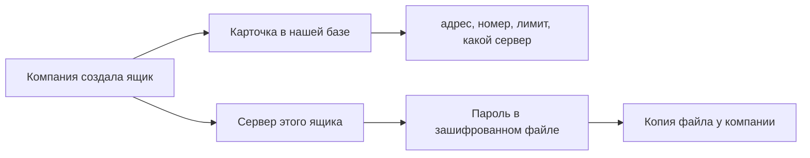

# Видение: первый контакт на объёмах плана

Денис Бутылин, 16.11.2026. Для Алексея и руководителя отдела продаж.

## Коротко

Система делает первое касание и передаёт отделу тех, кто ответил или согласился получить предложение. Объёмы берём из плана: 350 тысяч касаний в первый месяц, 455 тысяч во второй, 591,5 тысячи в третий, дальше плюс 7% каждый месяц. Под эти числа отдел продаж считает людей.

Ящики, которые уже пишут, в эту систему не передаём. Они продолжают работать как сейчас. Результат считаем на новых ящиках. Их компания создаёт сама, на своих номерах. Ящики не покупаем и не берём у поставщиков аккаунтов. Учёт ящиков ведём внутри компании. К номеру есть доступ через веб или по API. Код из SMS для входа в ящик приходит по API.

Первое письмо — предложение помочь сохранить репутацию на площадках. Текст выверен. В письме есть отправитель и отписка. Отказ останавливает все каналы.

Каналы: почта, WhatsApp, ВКонтакте, Telegram, звонок, чат на сайте, форма на сайте. Пишем туда, где у компании этот канал есть. Почта и телефон одной записи связаны. После письма известно, на какой номер звонить. Звонок идёт с номера того ящика, который письмо отправил.

Голос ведёт Vapi или другой зарубежный оркестратор. Свои видеокарты для звонков не нужны.

## План по месяцам

Касание — одно обращение в одном канале.

| Месяц | Касаний в месяц | Касаний в день |
|---|---|---|
| 1 | 350 000 | около 11 700 |
| 2 | 455 000 | около 15 200 |
| 3 | 591 500 | около 19 700 |
| дальше | плюс 7% каждый месяц | |

Основной объём несёт почта: около 100 писем в день с одного ящика, круглосуточно. На встрече это и есть девять писем в минуту.

| Месяц | Ящиков на 100 писем в день |
|---|---|
| 1 | 117 |
| 2 | 152 |
| 3 | 198 |

Эти ящики компания создаёт сама. Уже работающие в этот счёт не входят. Следующую партию заводим заранее, до начала второго и третьего месяца.

## Что получает отдел продаж

По ответу на письмо: удовлетворительно 0,5%, хорошо 1%, отлично 2%. Отдел планирует людей под хороший результат, 1%.

| Месяц | Ответов в день при 0,5% | при 1% | при 2% |
|---|---|---|---|
| 1 | 58 | 117 | 233 |
| 2 | 76 | 152 | 303 |
| 3 | 99 | 197 | 394 |

Карточка создаётся, когда человек ответил или в звонке согласился получить предложение. Один клиент — одна карточка.

По текущей модели компании из тех, кому после согласия ушло предложение, клиентами становятся 6%. На хорошем результате первого месяца это около 3 500 ответов и около 210 клиентов, если предложение получили все ответившие. Во второй месяц около 270 клиентов, в третий около 350.

Звонок, как и раньше, даёт около 30% согласий «пришлите информацию». Предложение после согласия уходит само, на почту или в мессенджер этой записи.

В карточке: компания, канал, переписка, ушло ли предложение, запись звонка и номер, с которого звонили. Отказ менеджера закрывает компанию во всех каналах.

Менеджер не набирает первое письмо. Он работает с теми, кто ответил или согласился.

Молчание компанию не закрывает. За месяц по одной компании делаем не меньше 12 касаний. Они идут по каналам, которые у неё есть, с паузой, а не пачкой в один день. Ответ или отказ останавливают серию раньше. Поэтому 350 тысяч касаний по-прежнему дают около 117 ответов в день при 1%: одна компания за месяц может забрать из них несколько касаний.

## Как идёт одна компания

1. Есть почта — отправляем предложение помочь с репутацией на площадках.
2. Ответа нет — следующее касание в другом канале этой записи. После письма звоним на телефон той же записи с номера ящика, который уже написал.
3. Каналы кончились, а ответа нет — в том же месяце возвращаемся ещё раз.
4. Есть согласие — предложение уходит на почту или в мессенджер, который у компании есть, в том числе в WhatsApp. В отдел падает одна карточка.
5. Отказ в любом канале закрывает компанию везде.
6. За месяц набралось 12 касаний и ответа нет — до следующего месяца не пишем.

Мессенджеры и звонки идут 18 часов, с учётом часового пояса компании. Почта идёт круглые сутки, не больше 100 писем с ящика.

## Каналы

- **Почта.** Старт и основной объём. Новый ящик Gmail, который завела компания, и его номер.
- **Звонок.** Vapi или другой зарубежный оркестратор. Согласие само ставит отправку предложения.
- **WhatsApp, ВКонтакте, Telegram.** Тот же номер компании. Код входа берём из SMS API. Пишем, только если канал у компании есть. Около 100 сообщений в день, 18 часов.
- **Чат и форма на сайте.** Ответ приходит на тот же ящик.

Если канал молчит, берём следующий, который у компании есть. Остановка одного канала не останавливает остальные и не заканчивает кампанию.

## Где живёт аккаунт

Аккаунт — это две разные вещи, и лежат они в двух разных местах.

Карточка отвечает на вопрос «кто это». Она хранится в нашей базе: адрес ящика, номер компании, какие каналы с него можно вести, сколько писем в день разрешено и какой наш сервер с этого ящика отправляет. Пароля в карточке нет. По карточке программа решает, кому писать и с какого ящика. Сама она войти в почту не может.

Пароль отвечает на вопрос «как войти». Он лежит только на том сервере, который отправляет почту с этого ящика, в зашифрованном файле. Рядом с паролями других ящиков этого сервера, и больше нигде в рабочей системе. Если сервер потеряется, ящик у почты останется, а войти будет нечем. Поэтому зашифрованная копия того же файла хранится у компании, отдельно от базы клиентов. Общая база эту копию не читает и письма ею не отправляет.

Пример одной записи. В базе: ящик `manager-17@gmail.com`, номер компании, лимит 100 писем в день, отправляет сервер номер 3. На сервере 3: пароль этого ящика. В базе клиентов этого пароля нет.

Письмо уходит так. Программа смотрит карточку и говорит серверу 3: отправь текст на такой-то адрес, это твоё задание. Сервер сам берёт пароль из своего файла, отправляет письмо и сообщает, что письмо ушло. Пароль по сети в общую базу не возвращается.

Multilogin, Dolphin и Octo Browser для этого не нужны. Это чужие программы, в которых хранят облик браузера. Почта ходит обычной почтовой программой, по адресу ящика и паролю. Браузерный облик ей не требуется. Если положить учёт туда, ящики окажутся у чужого поставщика. Мы держим карточку у себя, а пароль на своём сервере.

## Почта

Ответы читает тот же ящик, который отправил письмо. Общего ящика на все ответы нет: его остановка глушила бы всю почту сразу.

Свои домены проверяем отдельно, на небольшой группе и на том же тексте, что и новые ящики Gmail. Если письма с доменов открывают чаще и на них отвечают чаще, а постоянное заведение новых доменов по деньгам устраивает, добавляем домены к парку. План касаний на эту проверку не ждёт. Его закрывают ящики, которые создаёт компания.

## Первые недели

- Рабочие ящики не подключаем. Компания создаёт первую партию новых и передаёт их в учёт.
- Подключаем номера, SMS API, базу и Vapi. Одно и то же письмо второй раз не уходит. Отказ запоминается. Молчание ставит следующее касание, пока за месяц не наберётся 12.
- Со второй недели ответы с почты приходят в отдел.
- Согласие в звонке само отправляет предложение.
- Дальше включаем WhatsApp, ВКонтакте, Telegram, чаты и формы. Месячный план держит почта. Остальные каналы добавляют касания там, где они у компании есть.
