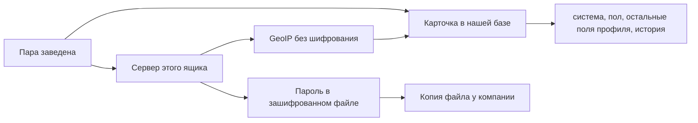

# Видение: первый контакт на объёмах плана

Денис Бутылин. Редакция 18.11.2026. Для Алексея и руководителя отдела продаж.

## Коротко

Система делает первое касание и передаёт отделу тех, кто ответил или согласился получить предложение. Объёмы берём из плана: 350 тысяч касаний в первый месяц, 455 тысяч во второй, 591,5 тысячи в третий. Это плюс 30% каждый месяц. Такой темп держится весь первый год: к 12-му месяцу выходит около 6,3 млн касаний. Со второго года по четвёртый темп плюс 7% каждый месяц. Под эти числа отдел продаж считает людей.

Ящики, которые уже пишут, в эту систему не передаём. Они продолжают работать как сейчас. Результат считаем на новых ящиках. Ящики не покупаем и не берём у поставщиков аккаунтов. Учёт ведём внутри компании. На входе номер компании и код из SMS по API. Первые пары заводим сами. Кто создаёт остальные, решаем после замера.

Первое письмо — предложение помочь сохранить репутацию на площадках. Текст выверен. В письме есть отправитель и отписка. Отказ останавливает все каналы.

Каналы: почта, WhatsApp, ВКонтакте, Telegram, звонок, чат на сайте, форма на сайте. Пишем туда, где у компании этот канал есть. Почта и телефон одной записи связаны. После письма известно, на какой номер звонить. Звонок идёт с номера того ящика, который письмо отправил.

Голос ведёт Vapi или другой зарубежный оркестратор. Свои видеокарты для звонков не нужны.

## План по месяцам

Касание — одно обращение в одном канале.

| Месяц | Касаний в месяц | Касаний в день |
|---|---|---|
| 1 | 350 000 | около 11 700 |
| 2 | 455 000 | около 15 200 |
| 3 | 591 500 | около 19 700 |
| 4–12 | плюс 30% каждый месяц | к 12-му месяцу около 6,3 млн |
| со 2-го по 4-й год | плюс 7% каждый месяц | |

Основной объём несёт почта: около 100 писем в день с одного ящика, круглосуточно. На встрече это и есть девять писем в минуту.

| Месяц | Ящиков на 100 писем в день |
|---|---|
| 1 | 117 |
| 2 | 152 |
| 3 | 198 |

Это арифметика при 100 письмах в день. Уже работающие ящики в этот счёт не входят. Первая ячейка — около 40 пар, её заводим сами. Сколько ящиков нужно на полный месяц и кто заводит следующие, решаем после замера: по дневному лимиту и по времени на одну пару. Дальше в первом году темп тот же, плюс 30%. Одной почтой на 100 писем в день он к 12-му месяцу потребовал бы около 2 100 ящиков, поэтому объём после первых месяцев держат и остальные каналы, которые уже есть у компании.

## Что получает отдел продаж

По ответу на письмо: удовлетворительно 0,5%, хорошо 1%, отлично 2%. Отдел планирует людей под хороший результат, 1%, и под полный объём месяца. Первая ячейка из около 40 пар этот объём не даёт: людей на 117 ответов в день считаем после замера.

| Месяц | Ответов в день при 0,5% | при 1% | при 2% |
|---|---|---|---|
| 1 | 58 | 117 | 233 |
| 2 | 76 | 152 | 303 |
| 3 | 99 | 197 | 394 |

Карточка создаётся, когда человек ответил или в звонке согласился получить предложение. Один клиент — одна карточка.

По текущей модели компании из тех, кому после согласия ушло предложение, клиентами становятся 6%. На хорошем результате первого месяца это около 3 500 ответов и около 210 клиентов, если предложение получили все ответившие. Во второй месяц около 270 клиентов, в третий около 350.

Звонок, как и раньше, даёт около 30% согласий «пришлите информацию». Предложение после согласия уходит само, на почту или в мессенджер этой записи.

В сигнал отделу входят компания, канал, переписка первого касания, ушло ли предложение, запись звонка и номер, с которого звонили. Входа в аккаунт первого касания в этом сигнале нет. Сигнал создаётся в двух случаях: положительный интент на почте или в звонке и любой ответ в мессенджере — WhatsApp, ВКонтакте или Telegram. Повтор того же ответа второй сигнал не создаёт.

Менеджеры отдела работают в одной среде, в AMOCRM. В систему первого касания и в аккаунты, с которых ушло касание, их не пускаем. Дальше диалог ведётся из AMOCRM с одного рабочего аккаунта отдела. Как клиент переходит на каналы отдела, опишет руководитель отдела или Алексей. Отказ в AMOCRM закрывает компанию во всех каналах первого касания.

Молчание компанию не закрывает. За месяц по одной компании делаем не меньше 12 касаний. Они идут по каналам, которые у неё есть, с паузой, а не пачкой в один день. Ответ или отказ останавливают серию раньше. Поэтому 350 тысяч касаний по-прежнему дают около 117 ответов в день при 1%: одна компания за месяц может забрать из них несколько касаний.

## Как идёт одна компания

1. Есть почта — отправляем предложение помочь с репутацией на площадках.
2. Ответа нет — следующее касание в другом канале этой записи. После письма звоним на телефон той же записи с номера ящика, который уже написал.
3. Каналы кончились, а ответа нет — в том же месяце возвращаемся ещё раз.
4. Есть положительный интент на почте или согласие в звонке — предложение уходит на почту или в мессенджер записи, в том числе в WhatsApp. В AMOCRM падает один сигнал. Диалог продолжает отдел со своего рабочего аккаунта.
5. Есть ответ в WhatsApp, ВКонтакте или Telegram — в AMOCRM падает такой же сигнал, с перепиской этого канала. Отдел в аккаунт мессенджера не входит.
6. Отказ в любом канале закрывает компанию везде.
7. За месяц набралось 12 касаний и ответа нет — до следующего месяца не пишем.

Мессенджеры и звонки идут 18 часов, с учётом часового пояса компании. Почта идёт круглые сутки, не больше 100 писем с ящика.

## Каналы

- **Почта.** Старт и основной объём. Новый ящик Gmail пары и его номер.
- **Звонок.** Vapi или другой зарубежный оркестратор. Согласие само ставит отправку предложения.
- **WhatsApp, ВКонтакте, Telegram.** Тот же номер компании, та же ячейка, что и у ящика. Код входа берём из SMS API. Пишем, только если канал у компании есть. Около 100 сообщений в день, 18 часов. Max в этом списке нет: он назван в разговоре 17.11.2026 и ждёт отдельного решения Алексея. Instagram, LinkedIn и Facebook относятся к позднему иностранному контуру, не ко второму и третьему месяцу.
- **Чат и форма на сайте.** Ответ приходит на тот же ящик.

Если канал молчит, берём следующий, который у компании есть. Остановка одного канала не останавливает остальные и не заканчивает кампанию.

## Где живёт аккаунт

Первый месяц закрывает почта. Первые пары заводим сами. Кто создаёт остальные, решаем после замера, когда известны число ящиков и время на одну пару. Во второй и третий месяц к тем же парам «ящик + номер» добавляются мессенджеры. Отдельного контура, где аккаунты «живут у поставщика профилей», нет.

Аккаунт — это три разные вещи, и лежат они в трёх разных местах.

Карточка отвечает на вопрос «кто это». Она хранится в нашей базе: адрес ящика, номер компании, какие каналы с него можно вести, сколько писем в день разрешено и какой наш сервер с этого ящика отправляет. В той же базе лежит вся история действий с аккаунтом, начиная с того дня, когда пара заведена, и профиль этого аккаунта. В профиле: операционная система, GeoIP, пол и остальные поля этого профиля. Пароля в карточке нет. По карточке программа решает, кому писать и с какого ящика. Сама она войти в почту не может. Окно, в котором видны Gmail, WhatsApp, Telegram и ВКонтакте, — это список этих карточек. Позже в том же окне виден иностранный контур: Instagram, LinkedIn, Facebook. У него своя база лидов, то же устройство карточки.

Пароль отвечает на вопрос «как войти». Он лежит только на том сервере, который отправляет почту с этого ящика, в зашифрованном файле. Рядом с паролями других ящиков этого сервера, и больше нигде в рабочей системе. Если сервер потеряется, ящик у почты останется, а войти будет нечем. Поэтому зашифрованная копия того же файла хранится у компании, отдельно от базы клиентов. Общая база эту копию не читает и письма ею не отправляет.

GeoIP отвечает на вопрос «с какого места выходит эта пара». Оно лежит на том же сервере ячейки, рядом с файлом паролей, обычной меткой, без шифрования, и в карточке профиля видно то же значение. Пара закреплена за этой ячейкой и на другую не переезжает, поэтому операционная система, адрес выхода и GeoIP у неё одни и те же. Операционная система, пол и остальные поля профиля лежат в карточке.

Пример одной записи. В базе: ящик `manager-17@gmail.com`, номер компании, лимит 100 писем в день, отправляет сервер номер 3, история писем и входов, профиль: операционная система, GeoIP, пол и остальные поля этого профиля. На сервере 3: пароль этого ящика и метка GeoIP. В базе клиентов этого пароля нет.

Письмо уходит так. Программа смотрит карточку и говорит серверу 3: отправь текст на такой-то адрес, это твоё задание. Сервер сам берёт пароль из своего файла, отправляет письмо и сообщает, что письмо ушло. Пароль по сети в общую базу не возвращается. Мессенджер этой пары выходит с того же сервера.

Multilogin, Dolphin, Octo Browser и другие платформы профилей для этого не берём. Почта ходит обычной почтовой программой, по адресу ящика и паролю. Мессенджер ходит с номера компании на своей ячейке. Если положить учёт в чужую платформу, ящики окажутся у поставщика. Готовое хранилище можно рассмотреть только если компания доверяет ему сильнее своей базы. Сейчас такого решения нет, и учёт остаётся у нас.

За аккаунтом смотрим обычный уровень его канала: сколько писем уходит, сколько ответов, сколько отказов. Аккаунт, который от этого уровня отошёл, останавливаем и ищем причину. Номер принадлежит компании, поэтому пароль можно сменить по SMS на этот номер.

## Где стоит Android

Мессенджеры выходят с отдельной машины. Это не сервер AMOCRM и не компьютер менеджера. К машине CRM мы не подключаемся и ничего на неё не ставим. Как устроены компьютеры отдела, кроме самой AMOCRM, нам знать не нужно: менеджер работает там же, где работает сейчас.

На этой машине живёт сам экран Android: эмулятор, а если канал на эмуляторе не живёт — настоящий телефон по USB. Экран здесь — окно приложения на устройстве, не картинка в браузере. Код запускается на той же машине и нажимает кнопки по мобильной вёрстке этого экрана, в её XML. Так подписи кнопок и поля остаются элементами приложения, а не кусками веб-страницы, которые съезжают, когда страница перерисовывается. Первая закупка — один такой компьютер, до старта мессенджеров. Стоит он у того, кто его обслуживает, отдельно от CRM.

Инженер смотрит этот экран удалённым рабочим столом: на своём мониторе открывается экран той машины, видны эмулятор и телефон. Такой вход есть только у инженера. Менеджерам его не заводим.

С AMOCRM машина разговаривает по API и больше никак. Туда уходит сигнал о ответе. Обратно приходят текст менеджера и канал. Отправку делает машина Android. Менеджер из CRM не выходит.

## Multilogin как проверка, не как схема

Рабочая схема — своя машина. Multilogin можно взять рядом на одну проверку, если захотим сравнить облачный телефон со своим экраном. В учёт аккаунтов он не входит.

Проверка отвечает на три вопроса. Открывается ли чат WhatsApp, ВКонтакте или Telegram на их телефоне так, что кнопки и поля читаются из XML экрана приложения, а не из HTML страницы. Уходит ли ответ менеджера из AMOCRM на этот телефон без того, чтобы кто-то сидел в их окне. Устраивает ли, что сессия и профиль этого телефона лежат у Multilogin, а не у нас.

Как это устроено у них по справке от 15 октября 2026 года. Их API создаёт и запускает облачный телефон и включает ADB. Сам он кнопки не нажимает. Нажатия и ввод делает тот же путь, что и на своём экране: ADB и Appium, дерево экрана в XML. ADB есть с Android 11, на Android 10 его нет. Пока телефон остановлен, ADB тоже выключен. Автоматизация API — с тарифа Pro 10.

Менеджеров эта проверка не касается. На их компьютеры и на сервер AMOCRM ничего не ставится. Сигнал и ответ ходят по API, как в рабочей схеме.

Если проверка показывает, что чат читается из XML и ответ из CRM уходит, вопрос к нам один: готовы ли держать сессию у поставщика. Пока ответа нет, закупаем свою машину и учёт не переносим.

## Почта

Ответы читает тот же ящик, который отправил письмо. Общего ящика на все ответы нет: его остановка глушила бы всю почту сразу.

Свои домены проверяем отдельно, на небольшой группе и на том же тексте, что и новые ящики Gmail. Если письма с доменов открывают чаще и на них отвечают чаще, а постоянное заведение новых доменов по деньгам устраивает, добавляем домены к парку. План касаний на эту проверку не ждёт. Его закрывают ящики пар. Кто заводит пары сверх первой ячейки, решаем после замера.

## Первые недели

- Рабочие ящики не подключаем. На входе номер компании и код из SMS по API. Готового ящика ещё нет.
- Первые пары заводим сами, вручную. Код читаем из SMS API. Пароль сразу на ячейку. В тот же день пара подключается и проходит контрольное письмо. На этих парах засекаем, сколько занимает одна пара.
- По шагам, которые реально прошли, пишем короткую инструкцию. Скрипта регистрации нет. Если номер регистрацию не принимает, его откладываем.
- Первая ячейка — около 40 пар. С неё снимаем долю во «Входящих», долю ответов, сколько ящиков на паузе и какой дневной лимит держится. На 350 тысяч при 100 письмах в день нужно около 117 ящиков, при 40 — около 290.
- Кто создаёт остальные пары, решаем после замера. В решении два числа: сколько ящиков нужно и сколько времени занимает одна пара. До замера исполнителя не назначаем. Отдел эти ящики не ведёт.
- Подключаем номера, SMS API, базу и Vapi. Одно и то же письмо второй раз не уходит. Отказ запоминается. Молчание ставит следующее касание, пока за месяц не наберётся 12.
- Со второй недели положительный интент с почты уходит сигналом в AMOCRM. Отдел в ящик не заходит.
- Согласие в звонке само отправляет предложение.
- Дальше включаем WhatsApp, ВКонтакте, Telegram, чаты и формы. Ответ в этих мессенджерах тоже уходит сигналом в AMOCRM. Месячный план держит почта. Остальные каналы добавляют касания там, где они у компании есть.
